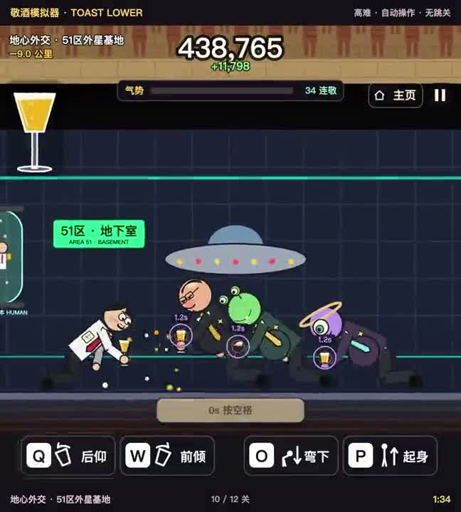

# Toast Lower

English | [简体中文](README.zh-CN.md)

**[Play now!](https://claslove.github.io/Toast-Lower/)**

## Hard-mode walkthrough

[](https://claslove.github.io/Toast-Lower/replay.html)

Hard difficulty, inertial controls, all 12 stages. Automated input, no stage skips, with music and sound effects. 1:57 · 9.4 MB.

## How to play

| Action | Desktop | Mobile (landscape) |
| --- | --- | --- |
| Steady the glass | Q / W or ← / → | Move the left stick sideways |
| Adjust height | O / P or ↓ / ↑ | Move the left stick up or down |
| Toast | Space | Tap the right-hand toast button |
| Smash through the floor | Hold O / ↓ during the floor-break phase | Hold the stick down |
| Pause | Esc / pause button | Top-right pause button |
| Return home | Top-right home button | Top-right home button |

On desktop, R restarts and M mutes. Choose a difficulty or open the tutorial from the home screen. On mobile, diagonal stick input controls both axes; releasing it preserves momentum. Rotating to portrait pauses the game.

The red **0s** marks the ideal toast timing. Run out of wine and the game ends. Missed toasts cost wine; completed rounds restore a little. Perfect toasts require both precise timing and a steady glass. Later glasses are smaller and hold less wine.

## Four chapters, twelve stages

| Chapter | Challenge |
| --- | --- |
| Workplace | Adjust your height and learn single toasts |
| Underground transit | Keep the glass steady while everything sways |
| Ancient tomb | Hold a fixed height and hit 2, 3, then 4 consecutive beats |
| Aliens | Three glasses count down together; identify and reach the real target in the final two beats |

Endless mode follows the twelve stages.

## Run locally

From the project directory:

```sh
python3 -m http.server 8783 --bind 127.0.0.1
```

Open <http://127.0.0.1:8783/> in your browser.

## Editing and checks

- `game.js`: rendering, physics, stages and controls.
- `config.js`: parameter defaults, ranges and units, with Chinese descriptions.
- `settings.js` / `settings.css`: hidden debug settings. Click “···” on the home or pause screen, or press Shift+D.
- `music.js` / `assets/audio/`: music playback and beat clock; `tools/make_music.py` contains the music synthesis source.
- `assets/home/`: current home background, logo and favicon.
- `tests/`: logic tests that run without a browser or GPU. See the [test notes](tests/README.md).

In-game settings are saved only in the current browser. Edit `config.js` to change the published defaults. No npm dependencies are required; use Node.js 22 or later:

```sh
npm test
npm run build
```

## Development

Developed with assistance from Codex and Grok.
